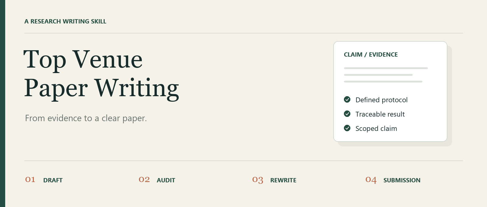

<p align="center"></p>

<p align="center">
  <a href="https://github.com/Shu-yin0/top-venue-paper-writing/actions/workflows/ci.yml"></a>
  <a href="LICENSE"></a>
  <a href="https://github.com/Shu-yin0/top-venue-paper-writing/releases"></a>
  
</p>

<p align="center"><b>English</b> · <a href="README.zh-CN.md">简体中文</a></p>
<p align="center"><a href="#quick-start">Quick start</a> · <a href="#four-ways-to-use-it">Workflows</a> · <a href="docs/paperlint.md">CLI guide</a> · <a href="examples/rewrites.md">Before & after</a></p>

# Top Venue Paper Writing

**Turn experimental evidence into a clear, defensible ML paper.**

An agent skill for drafting, rewriting and auditing empirical ML papers in the style of CVPR, ICCV, ICLR and NeurIPS. Start with a claim ledger, work through the sections that need attention, and finish with repeatable submission checks.

Use it in **Codex or Claude Code**, or read the checklists without an agent. The writing guides support English and Chinese; the optional linter focuses on English prose and LaTeX/Markdown source. No API key or third-party Python package is required by the included scripts.

> A writing workflow, not an acceptance guarantee. Not affiliated with or endorsed by the venues above. Current venue rules take precedence over the suggested defaults.

## What makes it useful

| Evidence first | Work at the right scope | Check what can be checked |
| --- | --- | --- |
| Connect each claim to a metric, protocol and evidence path. | Draft a paper, audit a draft, or improve just one section. | Flag repeated text, unsupported wording, missing supplement references and possible identity leaks. |

## Quick start

### 1. Get the skill

```bash
git clone https://github.com/Shu-yin0/top-venue-paper-writing.git
cd top-venue-paper-writing
```

### 2. Install for your agent

```bash
# Codex
python scripts/install.py --agent codex

# Or Claude Code
python scripts/install.py --agent claude
```

On macOS/Linux, use `python3` if `python` is unavailable. On Windows, `py` also works. The installer copies only the skill and its supporting resources, prints the destination, and refuses to overwrite an existing installation. Use `--dry-run` to preview or `--dest PATH` to select a different destination. See [installation and updates](docs/installation.md).

### 3. Ask for one concrete outcome

**Codex**

```text
Use $top-venue-paper-writing to audit my introduction.
Keep the technical claims unchanged. Return a revised draft,
an evidence-gap list, and a short explanation of the edits.
```

**Claude Code**

```text
/top-venue-paper-writing Audit my introduction. Keep the technical
claims unchanged and explain each substantive edit.
```

Provide the draft and available evidence files alongside the request. If the agent does not discover the new skill immediately, start a new session. You can also point an agent directly at [SKILL.md](SKILL.md).

## Four ways to use it

| Mode | Bring | Get |
| --- | --- | --- |
| **Draft** | Results, figures and a target venue | A claim ledger, evidence gaps and a section-by-section draft |
| **Audit** | An existing manuscript | A prioritized section audit, suggested changes and open decisions |
| **Rewrite** | One section and the claims it must preserve | Focused edits with reasons and evidence boundaries |
| **Submission** | Main text, supplement and venue requirements | Source checks, unresolved issues and a cold-read brief |

```text
Evidence → Claim ledger → Targeted section work → Whole-paper review → Submission checks
```

More copy-ready requests: [English / 中文 prompt cookbook](docs/prompts.md).

## Try the linter in 30 seconds

```bash
python scripts/paperlint.py words examples/demo-paper.tex --lists ai,risk
```

The synthetic example deliberately contains two phrases worth reviewing:

```text
[ai] leverage
[risk] outperforms
2 hit(s).
```

Output also includes the file, line number and surrounding text. Exit code **1** means the check found something to review; **0** means no findings; **2** means invalid input or a command error.

| Command | Checks |
| --- | --- |
| `length` | Abstract and conclusion against default word budgets |
| `words` | Style phrases, strong claims and vague hedges |
| `overlap` | Shared runs of words between files or selected sections |
| `suppmap` | Explicit `Supp.~S1`-style references against supplement sections |
| `anon` | Identity clues in text, filenames and basic PDF metadata |

See the [CLI reference](docs/paperlint.md) for commands, limitations and expected exit codes. The checks are heuristics: a flag is not proof of a problem, and a clean run is not submission clearance.

## Inside the skill

| Resource | Purpose |
| --- | --- |
| [SKILL.md](SKILL.md) | Mode selection and the working contract |
| [references/](references/) | 11 focused guides, including provenance and limits |
| [templates/](templates/) | Claim ledger, section audit, open decisions, change log and cold-read brief |
| [examples/rewrites.md](examples/rewrites.md) | Synthetic before/after rewrites with explanations |
| [docs/prompts.md](docs/prompts.md) | Ready-to-use English and Chinese requests |
| [scripts/paperlint.py](scripts/paperlint.py) | Five dependency-free source checks |
| [agents/openai.yaml](agents/openai.yaml) | Codex display metadata and a starter prompt |

## Working principles

- **Trace claims to evidence.** Do not invent experiments, numbers, citations or statistical support.
- **Preserve meaningful boundaries.** Stronger prose must not hide conditions or material counterevidence.
- **Keep authors in control.** Propose substantive changes and record unresolved decisions. Preserve the internal evidence ledger.
- **Load only what matters.** A section rewrite should not require a full-paper workflow.
- **Treat defaults as defaults.** Word counts, section patterns and vocabulary checks yield to the manuscript and venue requirements.

[Provenance and limits](references/sources-and-evidence.md) · [Contributing](CONTRIBUTING.md) · [Changelog](CHANGELOG.md)

## Development

```bash
python -m unittest discover -s tests -v
python scripts/validate_skill.py
```

GitHub Actions runs these checks on Linux and Windows, including Python 3.8 and 3.12. This validates the packaging and scripts; it does not measure the quality of generated papers.

## License

[MIT](LICENSE). Original copyright and attribution are preserved.
